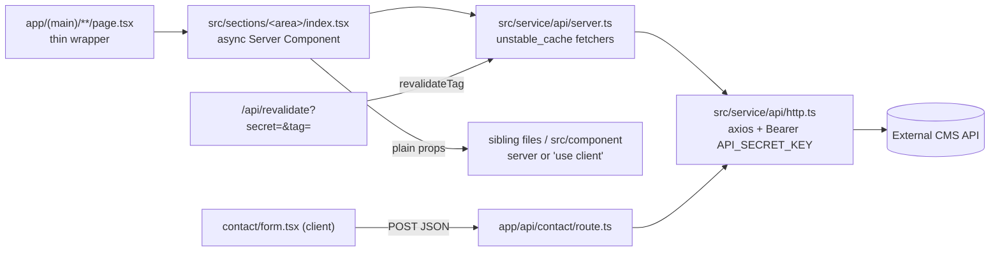

# Repository Guidelines

## Project Overview

Personal portfolio for Aditya Dharma (baharma.my.id, repo `baharma/portopolio-baharma`). It is a Next.js 16 App Router site, and almost all of its content comes from an external headless CMS API. The site renders a single CMS site: slug `portopolio-baharma`, `website_id`/`user_id` `3`.

## Architecture & Data Flow



- **Routes** (all live in the `app/(main)/` group; its layout adds `ComponentsNavbar` and `ComponentsFooter`):
  - `/` → `PagesHome` (`src/sections/home`)
  - `/about` → `SectionsAboutMe`
  - `/contacts` → `SectionsContact` (client)
  - `/[slug]` → `SectionExperience`. It branches on `slug === 'project'` (fetches products via `productApi({countLimit:10,id:3})`). Every other slug renders the experience page. There is no 404 for unknown slugs.
- **API routes**:
  - `app/api/contact/route.ts`: same-origin proxy. It checks required fields and returns 400 if any are missing, forwards to `/email` with `user_id: 3`, and returns 201 on success or 502 on failure. Any client write that needs the secret must go through a proxy route like this one.
  - `app/api/revalidate/route.ts`: GET with `?secret=` (checked against `REVALIDATE_SECRET`, 401 otherwise) and optional `&tag=home|main|experience|about-me|products`. It calls `revalidateTag(tag, 'max')`, the two-argument form Next 16 uses.
- **Fetchers** (`server.ts`): named exports `apiMain` (currently unused), `homePage`, `apiExperience`, `apiAboutMe` and `productApi`. Each wraps an axios call:
  ```ts
  export const apiAboutMe = unstable_cache(async () => {
      const { data } = await http().get(`website/slug/portopolio-baharma/page/about`)
      return data
  }, ['about-me'], { revalidate: 3600, tags: ['about-me'] })
  ```
  When you add a fetcher, give it a tag and add that tag to `KNOWN_TAGS` in the revalidate route.
- **CMS payload shape**: `data.workflows[0].value.<page_key>`. Fields are `{ key, label, type, value }` (`src/service/type/value.ts`). Keys currently in use:
  - `home_page.{hero_main,list,short_time_line,tool}`
  - `experience.{description,history[]}`
  - `about.schoold[]`. The `schoold` typo is the real CMS key; don't "fix" it.
  - Products: `item.description.value.description.{name_project,type_project,description_short,description_detail,image_list[],list_stack[]}` and `item.category.nama`.
- **Rich text**: `src/component/render-blog` (`BlogContent`) renders CMS Quill HTML with `dangerouslySetInnerHTML`. Its list markers come from the `.blog-content` CSS-counter rules in `app/globals.css`, so keep the component and that CSS in sync.

## Key Directories

| Path | Purpose |
|---|---|
| `app/` | Only route wrappers, layouts, API routes and `globals.css`. No UI logic. |
| `src/sections/<area>/` | Page sections. `index.tsx` fetches data; sibling files (`main-hero.tsx`, `list.tsx`, `timeline.tsx`, …) render it. |
| `src/component/<name>/index.tsx` | Shared UI: `navbar`, `footer`, `gradient-image`, `card-project`, `render-blog`, `button`, `button-underline`, `line`, `live-indicator`. |
| `src/service/api/` | `http.ts` (axios factory) and `server.ts` (cached fetchers). Server-only, though nothing enforces that with an `import 'server-only'` guard. |
| `src/service/type/` | The only shared type is `value`. |
| `src/uitls/gsapUtils.ts` | GSAP ScrollTrigger helpers. The directory name is misspelled `uitls`; keep that spelling. |
| `src/layout/`, `src/sections/blog/`, `src/sections/project/`, `src/service/web/`, `src/component/swite/`, `about-me/letswork.tsx` | Empty or dead. Not wired to anything. |
| `public/` | Only create-next-app SVGs, none of them referenced. |

## Development Commands

```bash
npm install
npm run dev          # http://localhost:3000
npm run build        # production build; includes the TS type check
npm run start
npm run lint         # eslint (flat config); `next build` does NOT run lint in Next 16
npx tsc --noEmit     # standalone type check (no script for it)
curl "http://localhost:3000/api/revalidate?secret=$REVALIDATE_SECRET&tag=home"
```

You need a `.env` file at the repo root (gitignored; there is no `.env.example`) with `NEXT_PUBLIC_API_URL`, `API_SECRET_KEY` and `REVALIDATE_SECRET`. Variables without the `NEXT_PUBLIC_` prefix are `undefined` in client bundles.

## Code Conventions & Common Patterns

- **Components**: each is a default export of a named `function`. Folders and files are kebab-case. Name prefixes are inconsistent: `Components*` for shared UI (`ComponentsNavbar`), `Sections<Area><Part>` for section sub-parts (`SectionsHomeToolkit`, `SectionsExperienceList`), plus outliers `PagesHome`, `SectionExperience`, `GradientImage`, `BlogContent`. For new code, use `Sections<Area><Part>` and `Components<Name>`.
- **Services/utilities**: named exports (`export const http`, `export const homePage`).
- **Imports**: use the `@/src/...` alias, which maps to the repo root. Use `./x` for siblings inside a section folder.
- **Server vs client**: fetch data only in server `index.tsx` files and pass plain props down. Add `"use client"` only for interactivity or GSAP. Client components must never import `src/service/api/server.ts`; `home/card-project.tsx` currently violates this.
- **State**: local `useState` only. There is no context, store or React Query. `@tanstack/react-query` is listed in `package.json` but never imported.
- **Error handling**:
  - Server sections and fetchers handle errors only with optional chaining. There is no try/catch, `notFound()`, `error.tsx` or `loading.tsx`, so API failures surface as Next's default error page.
  - Several places dereference CMS data without a guard (`heroValues.list`, `dataCurrently.map`, `dataProduct.slice`, `data.map` in the about timeline). Use `?.` and `?? []` when wiring new CMS fields.
  - `try/catch` exists only in the contact proxy and `contact/form.tsx`, which uses a `Status` union state machine.
- **Typing**: `tsconfig` sets `strict: true`, but most props are `any`, which lint flags as an error. Prefer an `interface XxxProps` or `type Props` and reuse `value` from `@/src/service/type/value`.
- **Images**: always use `GradientImage` (`src/component/gradient-image`). It wraps `next/image` with `fill`, so the parent must be `relative` and have a size. It supports `fallbackSrc` and `enableLightbox`. `next.config.ts` has no `images.remotePatterns`, so every remote CMS image must pass `unoptimized`.
- **Animations**: `useGSAP` from `@gsap/react` plus the class hooks `.show-text-on-top`, `.show-text-on-left` and `.show-text-on-right`. The class has no effect unless a client component calls the matching `gsapShowTextOn*()`; today only `about-me/timeline.tsx` and `contact/index.tsx` do. Any `gsap.from(..., { scrollTrigger })` call must import `gsapUtils` (which registers ScrollTrigger) or register the plugin itself.
- **Styling** (Tailwind v4, configured CSS-first in `app/globals.css`; there is no `tailwind.config`):
  - **Colours**: `primary`, `secondary`, `tertiary`, `quaternary`, `quinary` (navy palette).
  - **Fluid type/radius**: `text-8d`…`text-80d`, `rounded-8d/10d/15d`. These scale with `--bw`, the design width: 375 on mobile, 480 on portrait tablet, 1280 by default.
  - **`--spacing` override**: `:root { --spacing: calc(100vw / var(--bw)) }`, so every numeric spacing/size utility (`p-6`, `w-200`, `gap-10`) is viewport-relative, in design-px. Use arbitrary values like `w-[44px]` when you need a fixed size.
  - **Container idiom**: `md:max-w-6xl lg:max-w-8xl xl:max-w-10xl mx-auto`.
  - **Fonts**: `font-instrument-serif` and `font-pacifico`. `body` defaults to Arial.
- **Formatting**: VS Code's built-in TS formatter with ESLint fix-on-save; there is no Prettier. Use 4-space indentation in `src/`, double quotes in JSX/imports, and match the file's existing semicolon style. Comments mix English and Indonesian.
- **Commits**: Conventional Commits (`feat: …`, `fix: …`) on the single `main` branch.

## Important Files

- `app/layout.tsx`: root layout with fonts. `metadata` is still the placeholder "Create Next App", and there is no per-page `generateMetadata`.
- `app/(main)/layout.tsx`, `app/(main)/[slug]/page.tsx`: shared chrome and the multi-purpose dynamic route.
- `src/service/api/server.ts`, `src/service/api/http.ts`: the whole data layer. `http()` builds a new axios instance on every call. Endpoint paths mix leading-slash and bare forms.
- `app/globals.css`: all design tokens and the `.blog-content` styles.
- `src/component/gradient-image/index.tsx`: image, skeleton, lazy-load and lightbox portal.
- `src/component/navbar/index.tsx`: nav links. The mobile menu links to `/projects` but desktop links to `/project`; only `/project` shows products.
- `eslint.config.mjs`, `tsconfig.json`, `next.config.ts` (empty), `postcss.config.mjs`.
- Content that is hardcoded rather than coming from the CMS: contact info in `contact/index.tsx` and `home/email-show.tsx`, the CV link in the navbar, and the name in `home/main-hero.tsx` and the footer.

## Runtime/Tooling Preferences

- Node ≥ 20.9, which Next 16.2.4 requires. Use **npm** only: the repo has `package-lock.json` (v3) and no other lockfile.
- Pinned versions: `next`, `react`/`react-dom` 19.2.4 and `eslint-config-next` 16.2.4. Tailwind 4, GSAP 3, axios 1, TypeScript 5 and ESLint 9 use caret ranges.
- There is no CI, Dockerfile or deploy config. Hosting is presumably on Vercel (inferred from `.vercel` in `.gitignore`). The README is unmodified create-next-app boilerplate.

## Testing & QA

- **No test framework, tests, CI or git hooks.** The checks are:
  - `npm run lint`. Baseline as of this writing: 14 errors and 10 warnings, mostly `no-explicit-any` and unused imports in `src/sections/home/*`, plus `<a href="/blog/...">` in `home/blog.tsx`. Don't add new errors.
  - `npx tsc --noEmit`, which currently passes.
  - `npm run build`.
- Verify UI changes manually with `npm run dev` against a real `NEXT_PUBLIC_API_URL`. Check mobile (<768px), portrait tablet and desktop widths, because sizing depends on `--bw`.
- After changing CMS content or fetchers, hit `/api/revalidate` instead of waiting out the 3600 s cache.
